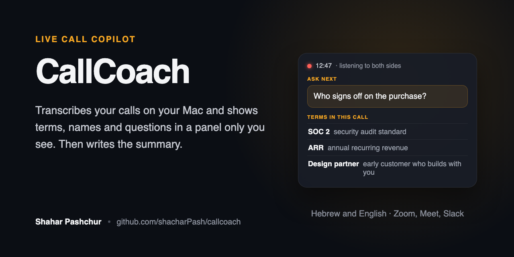

# CallCoach



A private live call copilot for macOS. While you are on a call (Zoom, Meet, Slack, WhatsApp, any app), CallCoach transcribes both sides locally in Hebrew and English, and an AI agent shows short suggestions, terms and questions in a floating panel only you can see. When the call ends it writes a summary if you ask for one.

Transcription runs on your Mac with whisper.cpp. Only the text goes to the agent (your Claude subscription or an Anthropic API key). Audio never leaves the machine.

When the call ends, each turn of each side of the recording is transcribed once more as a whole, in the background, with the call's names and terms. Whisper then hears a turn's sentences together rather than in the live pieces of a few seconds, and this final transcript replaces the live one. A new call can start at once: the final pass waits while it records.

Headphones are not needed: the echo of the other side that the mic picks up from the speakers is removed on the Mac too, with WebRTC's echo canceller, before anything is recorded or transcribed. On headphones (Bluetooth or the headphone jack) there is no echo, so the mic goes on exactly as it came, even when you talk over the other side.

This is a personal project, shared as is. It works for me every day, but expect rough edges.

Recording a call can require the consent of everyone on it, depending on where you and they are. That is your responsibility.

## Requirements

- A Mac with Apple Silicon and macOS 14.2 or later (the system audio tap needs it).
- The Xcode Command Line Tools: `xcode-select --install`.
- About 2.5 GB of free space for the speech models.
- A Claude subscription or an Anthropic API key, for the agent. Transcription and recording work without one.

Everything else (uv and Python, ffmpeg, the whisper models, whisper-server, the Claude Code CLI that the Agent SDK bundles) is downloaded or built by `setup.sh`, each pinned to a version and checked against a SHA-256.

## Install

```bash
git clone https://github.com/shacharPash/callcoach.git ~/callcoach
cd ~/callcoach
./setup.sh
```

`setup.sh` installs the tools and models into `~/.callcoach`, builds the microphone helper and the app, and copies `CallCoach.app` into `~/Applications`. It is safe to run again, and it skips what is already there. The app is built on your Mac and signed ad hoc, so Gatekeeper does not block it.

The app runs the engine from the folder you cloned into, so keep the clone where it is (or run `./setup.sh` again after moving it).

Then:

1. Open CallCoach from `~/Applications`. It lives in the menu bar (a speech bubble). The main window has four tabs: "בית", "שיחות", "תדריכים" and "הגדרות".
2. In "הגדרות", on the "חשבונות" page, click "הוסף חשבון": a Claude subscription (it opens the Claude login in Terminal) or an API key (kept in the Keychain).
3. Start a call from "בית" with "התחל שיחה" (or ⌃⌥S), or "הקלטה בלבד" to record and transcribe without the agent. macOS asks once for the microphone and for system audio recording. Both are needed: the microphone for your side, system audio for the other side.

Your calls, transcripts, briefs and knowledge files are kept in `~/CallCoachData` (you can change it in "הגדרות"). Nothing there is ever part of this repo.

Optionally, "העתק כל שיחה לתיקייה" in "הגדרות" copies every finished call's summary and transcript (never the audio) to a folder you choose. Pick one that Google Drive for desktop syncs and they go up to Drive.

The full guide, in Hebrew, is in [docs/guide.he.md](docs/guide.he.md). The design is in [docs/specs/2026-11-15-callcoach-design.md](docs/specs/2026-11-15-callcoach-design.md).

## Updates

A minute after CallCoach opens, and once a day after that, it runs `git fetch` in your clone to see whether `main` on GitHub has new commits. That is all it sends. When there are, "עדכן את CallCoach…" shows at the top of the menu bar menu and one notification says so (never during a call: it waits for the call to end). Clicking it asks first, then the app closes, moves your clone forward (`git pull`, only when that is a straight move forward and never over changes of your own), runs `./setup.sh` again and opens again on its own, with a notification that says how it went. If `setup.sh` fails, the clone goes back to where it was and `setup.sh` runs once more for that version. The log is in `~/.callcoach/logs/update.log`.

Turn the check off with "בדוק עדכונים" in the same menu. A folder that is not a clone of this repo is never checked. To update by hand instead:

```bash
cd ~/callcoach && git pull && ./setup.sh
```

Then quit CallCoach and open it again.

## Development

```bash
.venv/bin/python -m pytest
```

runs the engine tests. `~/Applications/CallCoach.app/Contents/MacOS/CallCoach --self-check` runs the app's own checks.

## Prep agent (Claude Code plugin)

This repo is also a Claude Code plugin marketplace (named `callcoach`) with one plugin, `callcoach`. It lets a chat agent prepare call briefs and refresh your knowledge files from your own sources.

Add the marketplace from a local clone and install the plugin (in your shell):

```bash
claude plugin marketplace add ./path/to/callcoach
claude plugin install callcoach@callcoach
```

Or add it from GitHub:

```bash
claude plugin marketplace add shacharPash/callcoach
claude plugin install callcoach@callcoach
```

Inside a Claude Code session the same works as `/plugin marketplace add <path or owner/repo>` and `/plugin install callcoach@callcoach`.

Two skills:

- `prep`: ask it to prepare you for a call ("prepare me for a call with Acme"). It asks up to four short questions, researches the web, your sources and your knowledge files (read only), and writes a brief into `<data>/briefs/`. CallCoach shows it under "השיחות הבאות" on "בית". New people and companies it learns go into `<data>/knowledge/מהכנות.md`, after a backup.
- `update-knowledge`: refreshes the knowledge files from your sources, with a backup first and your own lines kept.

Where your information lives is written once, on the first run, to `<data>/sources.md` (the data folder is `defaults read app.callcoach dataDir`, else `~/CallCoachData`). That file is local and personal: it never lives in this repo, and the plugin itself contains no personal information.
